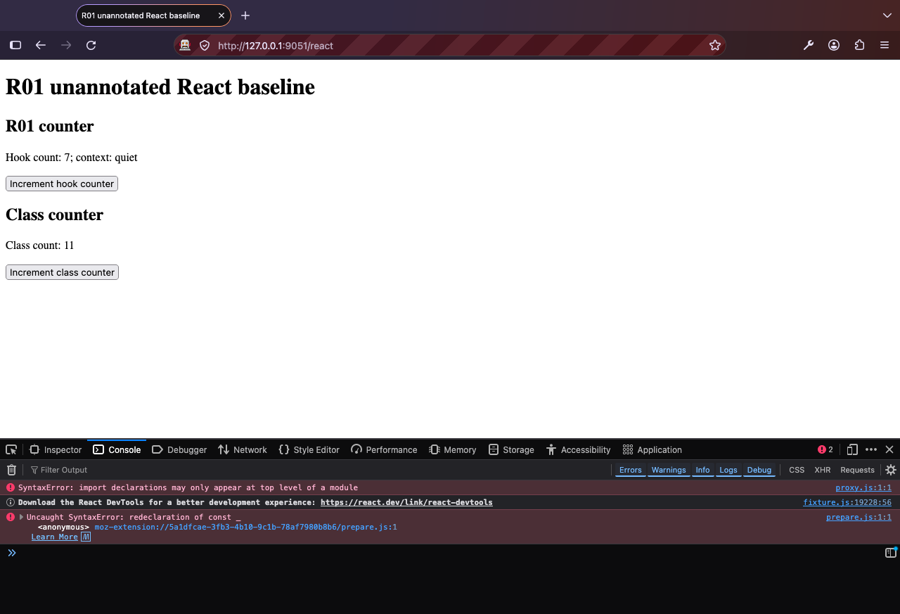

# R01: Installed Extension Failure Baseline

Issue: [#246](https://github.com/jared-leddy/react-devtools/issues/246).
Application source commit: `3c2a1e43baf42fb029f4c2262f95c198bf41db7d`.
Capture window: October 11-12, 2026, America/New_York. Individual UTC timestamps
are recorded in [baseline.json](evidence/baseline.json).

## Result

The unmodified built extension fails before useful native panel inspection in
both installed browsers. This is stronger than a layout problem: neither browser
exposes a usable React panel in these captures. **R01 reproduces the failures; it
does not fix them or establish release readiness.**

Three concrete startup failures were observed:

1. **Chrome's native extension host is blocked.** Its `devtools.html` target has
   the real inspected tab ID, but its document is `chrome-error://chromewebdata/`
   with `ERR_BLOCKED_BY_RESPONSE`. The React tab is unavailable. The leading
   explanation is the manifest's `frame-ancestors 'none'` policy, which conflicts
   with the framed DevTools host. A relaxed-policy comparison was not performed;
   the exact corrective policy still needs native-browser verification.
2. **Classic page scripts collide in their global namespace.** Chrome reports
   `Identifier '_' has already been declared`; Firefox reports
   `SyntaxError: redeclaration of const _` in `prepare.js`. The built detector and
   prepare scripts reuse minified top-level identifiers in the same page realm.
   Chrome installs its hook before this failure; Firefox's injected prepare fails
   and the React-only fixture has no hook. Both browsers also report this failure
   on the non-React control.
3. **Firefox rejects a module-formatted classic content script.** `proxy.js`
   starts with an import, but is loaded by `content_scripts` as a classic script.
   Firefox reports `SyntaxError: import declarations may only appear at top level
of a module`. This prevents the relay from opening. The error is visible in the
   native console, not inferred from a mocked extension API.



## Environment

| Item                 | Observed Value                                                       |
| -------------------- | -------------------------------------------------------------------- |
| OS                   | macOS 15.5, build 24F74                                              |
| Chrome               | 154.0.8037.98, native headed browser                                 |
| Firefox              | Developer Edition 158.0, build 20261007115609, native headed browser |
| Chrome extension     | Package/manifest 0.0.16; unpacked temporary installation             |
| Firefox extension    | Package/manifest 0.0.7; temporary installation                       |
| Node                 | 24.16.0                                                              |
| React / React DOM    | 19.1.1                                                               |
| Next.js              | 15.5.25, development Pages Router                                    |
| Capture dependencies | Playwright 1.63.0; esbuild 0.28.2                                    |

Builds used the repository's installed dependencies and ordinary extension build
commands. No extension source, manifest, hook, transport, or UI was patched for
the capture. Per-file hashes of the actual JS/CSS/HTML/manifest artifacts are in
`baseline.json`; retained evidence hashes are in
[checksums.json](evidence/checksums.json). These are development builds, not signed
Firefox packages or approved Chrome Web Store releases.

## Application Ground Truth

[fixture.tsx](fixture.tsx) is a minimal real React application, not a mocked
component tree. It imports only React and React DOM. It has no DevTools adapters,
DOM component annotations, synthetic inspector values, or panel imports.

| Component              | Expected Actual Value                                         | Observed App Interaction          |
| ---------------------- | ------------------------------------------------------------- | --------------------------------- |
| `BaselineApp`          | Real function component/root                                  | Rendered normally                 |
| `BaselineCounter`      | Prop `label = "R01 counter"`; hook state `7`; context `quiet` | Hook count changes from 7 to 8    |
| `BaselineClassCounter` | Class state `{ count: 11 }`                                   | Class count changes from 11 to 12 |

Both browsers execute those interactions successfully. Chrome's read-only
app-side Fiber observation also finds the actual three names, counter prop, hook
value and class state. **That observation is diagnostic ground truth, not panel
RPC success.** No component IDs, hook names or values were manufactured for UI.

The existing `/pages-demo` is a second real-app reproduction. Its plain React
components have no `data-devtools-component` annotations, but its `_app` does
register the existing Next adapter. It is not described as adapter-free. Chrome
sees React 19.1.1 plus Next's development renderer
`19.2.0-canary-0bdb9206-20250818`, each with one root.

## Native Capture Matrix

| Scenario            | Chrome                                                                                                  | Firefox                                                                                                              |
| ------------------- | ------------------------------------------------------------------------------------------------------- | -------------------------------------------------------------------------------------------------------------------- |
| React-only `/react` | Real renderer/root and named Fibers exist; blocked extension host; detector redeclaration; no React tab | Working React app; proxy import and prepare redeclaration errors; no hook/registered renderer observed; no React tab |
| HTML `/non-react`   | Zero renderers; blocked host and detector redeclaration remain                                          | Zero renderers; same injection errors; no React tab                                                                  |
| Next `/pages-demo`  | Two real renderers/roots; blocked host; detector redeclaration; no React tab                            | Working app; same injection errors; hook object exists but no registered renderers observed; no React tab            |

The non-React control should not have a React tree, but it should not incur
extension script syntax errors either. Absence of a panel here is not an honest
in-panel empty-state test: the panel never starts.

Chrome DevTools was opened automatically before app navigation in disposable
profiles. Firefox's native toolbox was opened after app navigation using its
built-in browser-chrome automation. Both are actual browser DevTools hosts, not
`smoke.html`, an ordinary tab pointed at `devtools-panel.html`, or an invented
`inspectedWindow` object. No user browsing profiles were reused.

For the React-only capture, the evidence retains Chrome's application target and
frame tree, the native frontend's parent/child extension-host relationship and
actual `inspectedTabId`. Firefox's observed browser URI, browsing-context ID and
window ID identify its actual inspected page. These are distinct native ID
namespaces, not invented common session IDs. Supplemental scenarios retain the
Chrome target relationships and Firefox toolbox's inspected URI.

| Requested Observation                    | Actual Baseline Outcome                                                                       |
| ---------------------------------------- | --------------------------------------------------------------------------------------------- |
| Page hook / renderer discovery           | Observed independently of panel startup, as above                                             |
| Backend injection                        | Chrome app has no `__react-devtools-user-app__` script before the blocked panel can bootstrap |
| Handshake / connection status            | Not reached; no successful backend handshake observed                                         |
| Component tree / selected state in panel | Not reached; the native React panel is unavailable                                            |
| App state changes                        | Observed 7 to 8 and 11 to 12 in both browsers                                                 |
| State changes delivered over RPC         | Not reached, not reported as a pass                                                           |
| Disconnected panel behavior              | Host/injection failure is reproduced; stale-state/reconnect UI cannot be exercised yet        |

The source-level `didOpenRpcClient: true` result is not a handshake observation.
Do not mark Connected based on construction or injection scheduling.

## Reproduce Manually

From the repository root, with its dependencies installed:

```sh
npm run build --workspace=@devtools/chrome-extension
npm run build --workspace=@devtools/firefox-extension
node docs/recovery/r01/serve-fixture.mjs
```

The server listens only on `127.0.0.1:9051`; generated bundles live in a temporary
directory and are removed when the server is stopped. A port conflict is an
error, not a reason to reuse an unrelated server.

1. Use a fresh Chrome profile. In `chrome://extensions`, enable Developer mode
   and load `packages/devtools-chrome-extension/dist` as an unpacked extension.
2. Open `http://127.0.0.1:9051/react`, then native Chrome DevTools. Check the main
   tab overflow for React. Inspect the page console for the redeclaration error.
   The recorded DevTools extension host is a blocked response; absence of a tab
   is not proof that the application has no React components.
3. Confirm the hook counter and class counter start at 7 and 11; click their
   buttons and confirm 8 and 12. Repeat against `/non-react`, which has no React
   imports or root.
4. Use a fresh Firefox Developer Edition profile. In
   `about:debugging#/runtime/this-firefox`, load
   `packages/devtools-firefox-extension/dist/manifest.json` temporarily.
5. Open the same URLs and native Firefox DevTools. Confirm the console's
   `proxy.js` import error and `prepare.js` redeclaration, missing React tab and
   working app counters. Do not load a smoke page to replace this check.
6. For the existing Next reproduction, start the playground separately:

```sh
npm run start:dev --workspace=@devtools/playground -- --hostname 127.0.0.1 --port 9050
```

Open `http://127.0.0.1:9050/pages-demo` in each profile and repeat the native
inspection. Stop the servers and close the disposable profiles afterwards.

Automation provenance: Chrome used its real native DevTools targets through CDP,
including the real extension host. Firefox used its built-in Marionette
browser-chrome context to open the native toolbox. These one-off captures are
not being presented as the required future Chrome/Firefox CI suites. Missing
browser prerequisites must fail closed in those suites.

Relevant primary documentation: [Chrome extension CDP loading](https://chromedevtools.github.io/devtools-protocol/tot/Extensions/),
[Playwright extension limitations](https://playwright.dev/docs/chrome-extensions),
[Marionette browser-chrome control](https://firefox-source-docs.mozilla.org/remote/marionette/Intro.html),
and [Firefox temporary installation](https://extensionworkshop.com/documentation/develop/temporary-installation-in-firefox/).

## Source Findings And Follow-Up

These findings supplement native observations; they are not fresh successful
UI screenshots:

- Chrome's framing policy is in
  `packages/devtools-chrome-extension/public/manifest.json:41`.
- Firefox's manifest loads `proxy.js` as a content script; its built entry keeps
  imports. `src/content/prepare-loader.ts:28` injects detector before prepare as
  ordinary scripts, sharing page-global bindings.
- Both `src/devtools-panel.ts` bootstraps mount the client without giving it the
  core RPC client, then discard the result of `createDevToolsCoreClient`.
- `packages/devtools-client/src/App.tsx:112` creates the synthetic tree;
  `:1863` chooses it when parent-DOM discovery returns empty.
- `packages/devtools-client/src/overview.ts` still includes hard-coded React
  version, root and commit timing. They must not be mistaken for backend facts.

Address the observed startup failures during
[R03 / #248](https://github.com/jared-leddy/react-devtools/issues/248), before
claiming its first installed-panel slice works. The final manifest/permission
audit remains [R33 / #278](https://github.com/jared-leddy/react-devtools/issues/278),
but postponing native startup until that milestone would block all intervening
inspection work. Validate classic-script bundling/isolation in both browsers;
do not solve syntax errors by relaxing extension script security indiscriminately.

Once startup works, [R04 / #249](https://github.com/jared-leddy/react-devtools/issues/249)
must demonstrate outbound updates and
[R05 / #250](https://github.com/jared-leddy/react-devtools/issues/250) must remove
the production synthetic authority. The unavailable tree/state observations
above must then be rerun in the real panel, not marked complete from source
changes alone.

## Coverage Limits

- No target-app URL or access was provided during this run. The React-only and
  existing Next apps are the reproducible substitutes; a private app was not
  accessed or exported.
- The official React extension was not installed in these disposable profiles.
  There is no fresh same-app official-extension comparison or coexistence pass.
  Those remain explicit evidence requirements for R02/R10, not inferred results.
- `_screenshots` is not present in this checkout. No fresh Vue comparison or
  visual approval is claimed. The approved recovery plan records the earlier
  screenshot review separately.
- Current native-host failures prevent meaningful panel tree/state, picker,
  store editing, reconnect and empty-state UI tests. This baseline documents
  those failures; it does not waive subsequent acceptance gates.
- Chrome early-opening and Firefox late-opening were captured, not a full
  cross-browser early/late/navigation matrix. R08/R29/R30 retain that work.
- Firefox temporary Developer Edition loading is not signed normal-Firefox
  installation. No store signing, submission or public release occurred.
- No production application behavior was changed. This evidence-only delivery
  does not bump app/package versions or relabel existing binaries as fixed.

## Retained Evidence

[baseline.json](evidence/baseline.json) contains build hashes, observed values,
native identities, errors and toolbox definitions. The screenshots contain only
the local public fixture/demo and native browser UI; no private app secrets or
personal browsing history are included.

- [Chrome app](evidence/plain-react-chrome-app.png) and
  [native DevTools without a React tab](evidence/plain-react-chrome-native.png).
- [Firefox native toolbox](evidence/plain-react-firefox-native.png) and
  [visible injection errors](evidence/plain-react-firefox-console.png).
- [Non-React Chrome control](evidence/non-react-chrome-native.png) and
  [Firefox control](evidence/non-react-firefox-native.png).
- [Next Chrome native capture](evidence/next-chrome-native.png) and
  [Next Firefox native capture](evidence/next-firefox-native.png).

Reproduction establishes that these builds fail. Passing existing unit,
coverage, packaging, bundle or overlay tests must not be cited as proof that
the installed native panel works.
