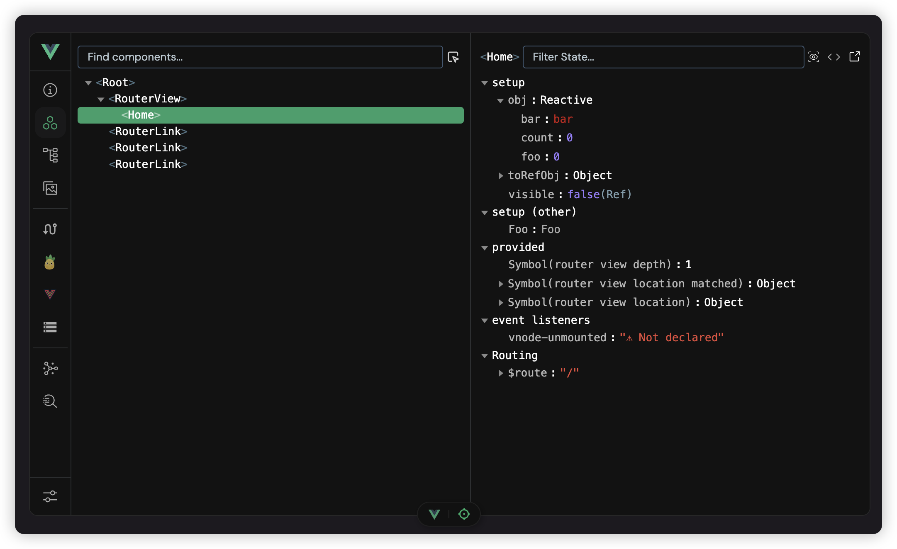
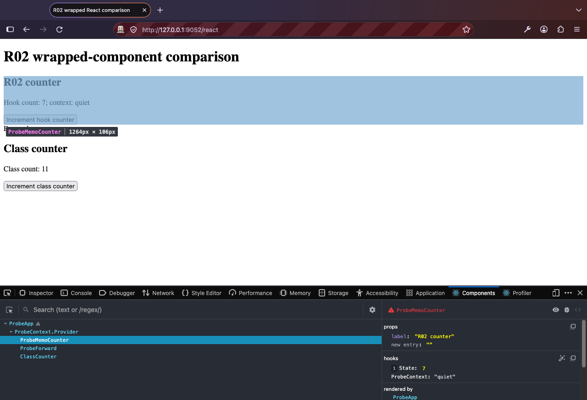

# R02: Reference Design And Backend Decision

Issue: [#247](https://github.com/jared-leddy/react-devtools/issues/247).
Investigation base: `938de25cbe21f1eee1ffc315677cce475fee8f86`.

**Status: measured specification awaiting explicit owner approval.** All 18
restored screenshots have now been inspected and the original Vue references
measured. Restoring them and requesting continuation is not visual sign-off.
Approval of the recovery backlog is not approval of this specification. R03 can
proceed independently; this investigation must not hold up basic transport wiring.

## Reference Authority

The original screenshots named in the [approved plan](../../../DEVTOOLS_RECOVERY_PLAN.md)
remain the visual authority. The local Vue source and documentation images are
secondary references, not replacements silently promoted to approved baselines.

| Reference                                                         | Availability / Use                                                                                            |
| ----------------------------------------------------------------- | ------------------------------------------------------------------------------------------------------------- |
| Owner Vue Components `01.15.35` through `01.16.18`                | Restored and inspected; measured rail/rows/panes/toolbars, typed selected states                              |
| Owner Routes `01.16.32`, `01.16.58`                               | Inspected summary/table and router inspector states                                                           |
| Owner Timeline `01.16.50`, Overview `01.17.05`, picker `01.17.32` | Inspected layers/empty events, brand/three summaries and picker surfaces                                      |
| Owner official React and our extension images                     | Inspected all seven; framework/server metadata versus our synthetic/nested-card UI                            |
| Local Vue `devtools/docs/public/features/components.png`          | Inspected; coordinate annotations below are from this image only                                              |
| Local Vue client/applet source                                    | Inspected; explicit source dimensions and behaviors below                                                     |
| Stores, Settings, popup, light/narrow/short/error states          | Missing original Vue states identified; source-derived grammar proposals require later view-specific approval |

Vue source is a tracked tree (`0cd44395df7664dde0e496acdf74daa71e042892`),
with package version `7.3.2`; an upstream commit is not recorded here. Do not
invent one. React-native semantics override Vue-specific labels (Hooks rather
than setup; registered Stores rather than assuming Pinia; actual React commit
events rather than Vue emits).

## Measured Owner References

[Owner annotation sheet](OWNER_REFERENCES.md) records content bounds, coordinate
marks, colors, interaction-state mapping and all 18 reference identifiers.
[owner-reference-measurements.json](evidence/owner-reference-measurements.json)
contains hashes/dimensions and reproducible pixel samples. Originals remain
unchanged in the owner's untracked `_screenshots` directory; browser chrome and
private application context are not redistributed in this PR/release.

Primary `01.16.18`: content 1920 x 828, starting at y=167; rail 50 raster px;
tree/inspector divided at x=985; toolbar 50px high; selected row exactly 20px;
selection sample `#419f69`, base `#121212`, separator `#2e3031`. Source suggests
14px monospace text and 15px indentation; screenshot pixels cannot prove the
installed font or browser zoom. The first image uses a different crop. These
measurements replace the secondary reference as the design authority.

## Historical Secondary Reference

Coordinates use the original **2162 x 1324 raster**, origin at top left, excluding
the decorative outer frame. They are annotations, not CSS pixel measurements of
the owner screenshots. Image/source hashes and pixel samples are in
[reference-measurements.json](evidence/reference-measurements.json).



| Mark                  | Raster Annotation                                  | Source / Interpretation                                                                       |
| --------------------- | -------------------------------------------------- | --------------------------------------------------------------------------------------------- |
| A: panel content      | Approximately x=70..2097, y=78..1243               | Compare content only; exclude black margin and decorative frame                               |
| B: rail               | x=70..171, approximately 100px wide                | Client `App.vue` specifies 50 CSS px collapsed, 250 expanded                                  |
| C: tree pane          | x=172..1132, 961px interior                        | One half of workspace; no card wrapper                                                        |
| D: divider            | x=1133..1134, 2 raster px                          | Subtle separator, draggable pane boundary                                                     |
| E: inspector          | x=1135..2095, 961px interior                       | Independent scroll and toolbar; no duplicate identity dashboard                               |
| F: selected row       | Solid sample at x=500, y=258..297; 40px high       | RGB 41,159,105 (`#299f69`); full-row selection with small corner radius                       |
| G: base surface       | Solid sample at x=300,y=400                        | RGB 18,18,18 (`#121212`)                                                                      |
| H: search toolbar     | Input at x~~187..1068, y~~110..164                 | Source pane padding `p2`, toolbar `py2`, search `text-3.5`                                    |
| I: text / indentation | Source `text-3.5`, `15 * depth + 4` px indentation | 14px text with default utility scale; typography is source-derived, not recovered from pixels |
| J: rail controls      | Source `h-10 w-10`, `p1`, 45px overflow capacity   | 40px controls, 4px rail padding; Settings pinned below scrollable tools                       |

The 100px raster rail and 50px source grid suggest a 2x rendering scale; this
inference does not prove the owner's screenshot scale. The 40px raster selected
row consequently suggests about 20 CSS px. Source specifies a responsive split
at pane width below 700px. Do not convert arbitrary screenshot coordinates using
OS DPI alone or copy rounded outer presentation framing into the panel.

## Shell And Components Specification

Values below are **measured proposals awaiting owner sign-off**, not an approval
claim. Use a 50px rail: the owner reference and source now agree. The plan's
earlier approximate 48px is superseded by this measurement. Use a 20px default
tree row, 50px toolbar band, 8px pane gutters and 27-28px search control.

- Full-viewport grid: fixed rail plus `minmax(0, 1fr)` workspace. No global title,
  Command/Dark buttons, pill navigation, section cards or document scrollbar.
- React-focused identity at rail top; no Vue logo or implied Meta endorsement.
  Overview, Components, Timeline and available adapters are grouped tools;
  Settings is pinned at bottom. Overflow never hides Settings or active tool.
- Use the existing suitable icon library or individually imported Lucide icons.
  Icon controls need names, hover/focus tooltips and keyboard access. Proposed
  rail hit target 40px, toolbar target 28px; icon glyph 16-20px.
- Neutral `#121212` dark surface, quiet `#2e3031` one-pixel separators, restrained
  green interaction accent; syntax colors add distinct types, not decoration.
  Selection `#419f69`, foreground `#ffffff`; validate contrast/focus in both themes.
  System/light/dark use semantic tokens, not a single dark-only style.
- Components uses flat resizable tree/inspector panes. Proposed default 50:50
  split; independent scroll, persisted ratio, accessible keyboard-operable divider.
  At insufficient width use master/detail with a Back control, not squeezed fields.
  Validate 360/420/700/1024px panel widths and 240/480/800px heights at 100/200% zoom.
- Left toolbar: `Find components...` and capability-backed picker icon. Right:
  selected name, `Filter State...`, supported DOM/source actions. Do not reproduce
  Vue render-code or arbitrary evaluation features without a safe real provider.
- Default 20px stable tree rows, 14px monospace data labels, 15px indentation.
  Selected background spans the row; hover and keyboard focus remain distinct.
  Arrow/Home/End navigation, disclosure, filtered ancestors, virtualized scrolling
  and selection reveal must work together without changing selected identity.
- Props, Hooks, State and Context are distinct collapsible sections when present.
  Values use typed inline trees with bounded previews and lazy expansion, not a
  JSON textarea. Hook ordinal/type is honest when custom-hook names are unavailable.
  Long names truncate with access to the full name; long values wrap or scroll
  inside their pane. Actions must not overlap or resize the row on hover.
- Generic component editing is read-only until a renderer-specific safe write
  capability exists. Registered store fields can expose validated adapter edits;
  readonly and unavailable are not presented as editable failures.
- Component IDs remain opaque and scoped to session/frame/renderer/root. Names
  come from actual type/wrapper metadata; never `component_01` as a display label.

The Overview reference contains three simple metric tiles below an unframed
brand. Preserve that hierarchy with true runtime facts; do not reinterpret it
as permission for nested dashboard cards. Stores/Settings/popup/light/narrow
proposals derive from inspected source/shared grammar, not absent screenshots.
Approve those actual screens in their implementation issues.

Known color risk: white on sampled `#419f69` has approximately 3.29:1 contrast,
below the 4.5:1 normal-text target. Measuring the reference is not a compliance
claim. Dark `#0b1015` text on that green gives approximately 5.81:1; white on
the darker timeline selection `#286746` gives approximately 6.73:1. R23 must
resolve the accessible selected-row treatment with owner visual review, preserving
the green/full-row grammar rather than blindly approving a failing contrast test.

Owner review should compare these measurements and our first **real installed
Components slice** at equivalent content dimensions, not a polished fake tree.
R16/R17 implement the shell/tree; R18 implements typed values; R23 verifies
keyboard, themes, density and responsive constraints.

## Reachable View And Capability Map

This inventory comes from `packages/devtools-client/src/routing.ts`, `App.tsx`,
and the recovery backlog. Route registration is not proof of live page data.

| Current / Planned Surface                           | Target Presentation                            | Data / Availability / Follow-Up                                                           |
| --------------------------------------------------- | ---------------------------------------------- | ----------------------------------------------------------------------------------------- |
| `/overview`                                         | Branded unframed runtime sections              | Real renderer/root/session summaries; unavailable timings stay absent; R05/R20            |
| `/components`                                       | Tree + typed inspector                         | Session tree and selected props/hooks/class/context; R03-R09/R17-R18                      |
| `/timeline`                                         | Layers + events + detail, record/clear         | Real commit/plugin subscriptions only; no invented layers; R24/R25                        |
| `/pages-routes`                                     | Compact adapter-backed summary/table/detail    | Requires React Router or Next adapter in inspected page; no panel-route counts; R11/R21   |
| `/react-router`                                     | Router tree/current location/detail            | Detected adapter capability; adapter absent means unavailable, not empty app routes; R21  |
| `/next`                                             | Client route/segment/runtime detail            | Next adapter; explicit App/Pages limitations and server boundaries; R21                   |
| `/assets`                                           | Dense asset list/preview                       | Vite host capability only; hidden in extension without provider; R21                      |
| `/graph`                                            | Unframed interactive dependency graph/detail   | Vite host capability only; existing workflow retained; R21                                |
| `/source-inspector`                                 | Source navigation/detail                       | Vite + source provider; no promised extension editor endpoint; R09/R21                    |
| `/settings` and plugin settings                     | Grouped compact controls                       | Theme/layout/preferences; advanced import/export disclosure/dialog; R20                   |
| `/custom-inspector-tab-view/:id`                    | Shared tree/value grammar                      | Page registration and remote read/edit dispatch; origin/plugin/session scope; R11/R12/R18 |
| Stores (missing dedicated workspace)                | Store tree + State/Getters/Actions inspector   | Genuine registered adapter; Nekuta vertical slice; not Components duplicated; R13/R19     |
| `/custom-tab-view/:name`                            | Same flat shell with bounded custom content    | Registered tab and trusted capability; remote iframe policy/security remains R15/R21      |
| Picker and highlight                                | Instruction/cancel + actual page overlay/label | Resolve real component/DOM target; Escape/navigation/disconnect teardown; R09/R22         |
| Extension popup and native tab identity             | Compact branded status/action surface          | Real inspected-tab state; no fake connection badge; R22                                   |
| Command palette, split/docking menus, value editors | Focus-managed functional transient tools       | Keep supported actions; host-only docking hidden elsewhere; R16/R18/R23                   |

## Runtime State Map

Use the same shell tokens and pane grammar in every state. This is a proposed
semantic mapping for R03, not a new protocol implementation.

| State                        | Required Observable Fact                          | Presentation / Actions                                                       |
| ---------------------------- | ------------------------------------------------- | ---------------------------------------------------------------------------- |
| Connecting                   | Handshake pending                                 | Compact status, no renderer/tree facts yet; timeout becomes actionable error |
| Connected, no React          | Successful session, no compatible renderer        | Honest no-React state; never replace with demo components                    |
| Connected, empty root        | Compatible renderer/root with zero surfaced nodes | Root identity retained; empty-tree message distinct from no React            |
| Unsupported                  | Known renderer/hook/protocol incompatibility      | Report observed version/reason; disable affected features only               |
| Permission/injection failure | Host denial, CSP or executable script error       | Specific failure and recovery action; not Connected or empty tree            |
| Disconnected/reconnecting    | Established session loses transport               | Mark cached values stale; no writes/picker until recovered snapshot          |
| Selection removed            | Root/node no longer exists in current revision    | Clear selected values/highlight; preserve tree navigation safely             |
| Filter has no matches        | Active filter excludes existing records           | Search-specific empty pane; clear-filter control                             |
| Missing capability           | Provider explicitly lacks action/data             | Hide unsupported tool/action; explain unavailable category where needed      |
| Store write pending/error    | Adapter returns validated revision/result         | Pending indicator, visible rejection, no optimistic fake success             |

## Bounded Backend Decision

**Recommendation: retain and correct the existing local backend for the first
real slice, behind a replaceable normalized session adapter.** This is conditional
on native R03-R07 evidence, not a finding that the current backend is adequate.
Do not introduce official backend runtime packages or vendor source in this
documentation issue. Do not require a full profiling investigation before R03.

R01's [native evidence](../r01/README.md) establishes three startup failures and
an official Firefox 6.1.1 control on React 19.1.1. The control has real names,
initial props/hooks/context and updated class state. Its after-update hook
snapshot is stale, so it is not a complete update oracle. Our native panel
cannot start; its tree/state/selection and coexistence remain unverified.

The committed [renderer probe](renderer-probe.mjs) uses actual React DOM 19.1.1
in jsdom 26.1.0, with the existing kit hook and compiled core walker. No synthetic
Fibers or mocked renderer are supplied. [Results](evidence/renderer-probe.json)
record actual module hashes, base commit, Node version and before/after values:

- Early hook installation yields one root in both development and production
  React package modes; real hook state changes 7 to 8 and class state 11 to 12.
- Context is correctly available as `ProbeContext = quiet`; the current generic
  hook inspector also duplicates it as an ordinal context hook.
- `forwardRef.displayName = ProbeForward` survives; the simple-memo tree uses
  inner `Counter`, not explicit wrapper `ProbeMemoCounter`. This is a concrete
  naming discrepancy for R06, not minification or an acceptable generated ID.
- Class state is present on the actual Fiber, but `getHooks(classFiber)` emits
  an `unknown` ordinal hook with no value. R07 must gate by component kind and
  deliver a separate State section, not expose this as a hook.
- Installing after renderer import/first render yields zero registered roots,
  despite functioning app updates. Late panel opening must rely on a hook already
  installed at document start; late hook injection is not a discovery strategy.

This probe is **DOM emulation, not a browser or extension test**. Production
React package selection is not optimized/minified application testing. The
native wrapped-component control below now complements these local observations;
production support and hook coexistence remain unverified.

### Native Wrapped-Component Comparison

On October 12, 2026, Firefox Developer Edition 158.0 (build 20261007115609)
loaded [native-fixture.tsx](native-fixture.tsx), React DOM 19.1.1 development,
at `http://127.0.0.1:9052/react`. It contains no DevTools imports or annotations.
Separate disposable profiles installed official React Developer Tools 6.1.1
and our unchanged Firefox 0.0.7 build. Native identities, complete toolbox
inventory, app values, source/build hashes and provenance are retained in
[native-comparison.json](evidence/native-comparison.json).

| Observation         | Local Walker Probe                                   | Official Native Panel                                                               |
| ------------------- | ---------------------------------------------------- | ----------------------------------------------------------------------------------- |
| Simple memo wrapper | `Counter` instead of explicit wrapper name           | `ProbeMemoCounter`; selection highlights the actual counter section                 |
| forwardRef          | `ProbeForward`                                       | `ProbeForward`; selecting it highlights the actual span                             |
| Context             | `ProbeContext = quiet`                               | Named provider in tree; selected counter context `quiet`                            |
| Props / hook        | Label `R02 counter`; 7 then 8                        | Correct label and initial 7; reselect after app update reads 8                      |
| Class state         | Actual Fiber 11 then 12; generic hook record invalid | Distinct State section `count: 12`; selecting it highlights class section           |
| Early ownership     | Early local hook gets root; late hook misses it      | Official-only profile discovers renderer/root; not a both-extension load-order test |



The automatic after-update official hook snapshot remained at 7 while the app
displayed 8. Explicitly reselecting the counter then displayed 8. This establishes
selected-read correctness, not reliable automatic pushes or a coexistence pass.
Our native extension again reports proxy import/prepare redeclaration errors,
no hook/renderers and no React tab; our panel selection remains unavailable.
This is a bounded behavior comparison sufficient to direct R06/R07, not a
claim that local jsdom proves native functionality. Startup fixes remain R03.

The official binary is not redistributed. The [reselected counter](evidence/official-counter-reselected.png),
[forwardRef selection](evidence/official-forward-selected.png),
[updated class](evidence/official-class-after.png) and
[our native errors](evidence/ours-firefox-console.png) are retained.

| Option                                     | Decision / Why                          | Cost And Remaining Evidence                                                                                                                                                                  |
| ------------------------------------------ | --------------------------------------- | -------------------------------------------------------------------------------------------------------------------------------------------------------------------------------------------- |
| Correct local hook/Fiber adapter           | First-slice recommendation              | Existing browser-safe model, no new runtime dependency; must fix naming, IDs, class/context and early ownership; R03/R06/R07/R10                                                             |
| Official inline backend behind our adapter | Contingency, not rejected categorically | Supports an embeddable backend entry; renderer fidelity may be better. Needs pinned source/API spike, bridge adaptation, hook safety and measured browser bundle. Do not import its frontend |
| Official core package wholesale            | Not selected for browser panel          | Outside-browser package includes `ws`/`shell-quote`; dependencies alone are not a measured browser cost or proof its backend cannot be selectively adapted                                   |
| Blindly copy React shared backend          | Not selected                            | Private coupled source/API and update/notices obligations; no provenance-free source fragments or arbitrary small-snippet exception                                                          |

Primary package manifests checked during this investigation:
[official core](https://github.com/facebook/react/blob/main/packages/react-devtools-core/package.json)
and [official inline](https://github.com/facebook/react/blob/main/packages/react-devtools-inline/package.json).
Both report 8.0.0/MIT in the checked source. These moving source links are not
a pinned candidate dependency or a promise about future published versions.
React's [MIT license](https://github.com/facebook/react/blob/main/LICENSE)
requires preservation of applicable copyright/license notices. No official
runtime code is copied or newly bundled by this issue.

### Ownership And Stop Rule

Repository maintainers own local Fiber compatibility/version guards and adapter
tests; React/Meta owns official upstream behavior. The implementing maintainer
records each tested React/browser change, repeats the fixture matrix and never
upgrades a vendored backend implicitly. Vue references retain `devtools/LICENSE`;
copied assets/code need source/version/notices, not Vue branding. R35 resolves
the repository MIT versus UNLICENSED metadata before distribution.

Keep raw Fibers, renderer interfaces and hook objects page-local. Core owns the
versioned serialized contract; the UI sees capabilities and records, never an
official agent's private objects. Transport/plugin editing does not depend on
which renderer adapter supplies component data.

If R06/R07 cannot demonstrate correct basic names/values for the first supported
candidate after R03 fixes native startup, record the concrete failing fixture and
evaluate only official inline's backend entry against that fixture. Bound the
spike to tree/selected-state output, isolation, notices and per-browser raw/gzip
delta. No frontend reuse, full profiler, React Native or speculative rewrite.
Return a reviewed retain/adapt decision before adding a dependency. Coexistence
failure triggers the same adapter decision under R10; it is not waived.

Current browser artifact limits (raw/gzip) remain unchanged: client library
190,000/42,000 bytes, standalone 430,000/130,000, overlay 230,000/75,000 and each
extension 500,000/160,000. R02 adds no production bytes. Official package unpacked
sizes are **not** browser payload measurements; no candidate browser bundle was
built here. R27 must review actual dependency graphs/deltas before any increase.

Current local build measurements (`npm run check:bundles`):

| Delivery          | Raw Bytes | Gzip Bytes |
| ----------------- | --------: | ---------: |
| Client library    |   160,523 |     34,679 |
| Client standalone |   363,556 |    109,692 |
| Overlay           |   202,691 |     63,012 |
| Chrome extension  |   424,239 |    133,677 |
| Firefox extension |   424,963 |    134,131 |

These are baseline totals, not a before/after backend adaptation comparison.
The generated [bundle report](evidence/bundle-report.json) is retained. No budget
is increased to accommodate this draft.

## Runtime Candidates, Not Support Claims

| Candidate                                           | Evidence Today                                                       | Required Release Proof / Limits                                                                                   |
| --------------------------------------------------- | -------------------------------------------------------------------- | ----------------------------------------------------------------------------------------------------------------- |
| React DOM 19.1.1 development                        | R01 native app + official Firefox control; local real-renderer probe | Our installed Chrome/Firefox tree, selection and live values still blocked                                        |
| React DOM 19.1.1 production                         | Real production package in DOM emulation                             | Minified app in both native panels, honest preserved/mangled names and unavailable source/hooks metadata; R28-R30 |
| React DOM 18.3.1 development/production             | Local guard admits major 18; not run in this investigation           | Independent pinned fixture and native matrix required; no support badge yet                                       |
| Next 15.5.25 Pages development                      | R01 app renders; Chrome discovers two roots/renderers                | Adapter-backed routes and correct selected renderer/session; native state not verified                            |
| Next 15.5.25 App development/production             | Candidate only, no fresh R02 execution                               | Hydration/client boundaries/Promise props; inaccessible server internals remain unavailable                       |
| Next bundled canary 19.2.0-canary-0bdb9206-20250818 | Observed renderer version in R01 Pages capture                       | Exact canary is a fixture observation, not generic 19.x/canary support                                            |
| Other React majors/renderers, React Native          | Outside initial support candidates                                   | Unsupported diagnostic; do not imply compatibility from matching Fiber tag numbers                                |

Development debug/source fields can be absent even on supported React versions.
Production does not guarantee recovery of original identifiers/custom-hook names.
Function/context metadata must be read from actual available fields, not inferred
from ID strings. Generic state writes and inaccessible server state are not v1
promises. Registered Stores read/write remains a required ecosystem feature.

## Reproduction And Automation Risks

From the root, build current dependencies before running each fresh process:

```sh
npm run build
NODE_ENV=development node docs/recovery/r02/renderer-probe.mjs
NODE_ENV=development node docs/recovery/r02/renderer-probe.mjs --late
NODE_ENV=production node docs/recovery/r02/renderer-probe.mjs
NODE_ENV=production node docs/recovery/r02/renderer-probe.mjs --late
```

The script asserts real app updates and early-root/late-missed-root behavior.
Unexpected failures exit nonzero; the observed backend discrepancies above are
recorded, not silently converted into claimed panel passes. Different runtime
versions require explicit new evidence rather than overwriting the old report.

Regenerate secondary-reference measurements with:

```sh
node docs/recovery/r02/reference-probe.mjs
node docs/recovery/r02/owner-reference-probe.mjs
```

The reference probe records manually annotated bounds separately from sampled
pixel colors and source-derived dimensions. It does not infer owner approval.

For the bounded native comparison, start `node docs/recovery/r02/serve-fixture.mjs`.
Use separate fresh Firefox profiles, install official 6.1.1 in one and our dist
in the other, then open `/react` and the actual native toolbox. Select memo,
forwardRef and class, increment the counters and reselect them. Record actual
native tool identity and injection errors; a normal extension URL tab is not
equivalent. Stop the fixture and close the disposable profiles afterwards.

Chrome R01 uses the actual native extension host/CDP relationship; extension
loading flags and browser versions can change. Firefox R01 uses real Marionette
browser-chrome tooling and built-in/additional toolbox definitions. Internal
DevTools DOM/tool IDs are not stable public test APIs. R29/R30 must retain native
identity, fail on missing prerequisites, and provide manual native release gates
where reliable automation is unavailable. Plain web pages and jsdom cannot stand
in for extension CSP, content-script execution, transport or native toolboxes.

## Remaining Acceptance Gates

- [x] Restore owner's Vue images; record hashes/content bounds and measure the
      rail, row, toolbar, panes, typography, colors and relevant interaction states.
- [x] Identify missing Vue reference states and map source-derived proposals to
      R19/R20/R22/R23; do not claim those screens have visual parity yet.
- [ ] Owner explicitly approves shell/Components specification or requests changes.
- [x] Complete bounded official/native wrapped-component naming and selection
      comparison; early hook ownership/coexistence remains R10, not a claimed pass.

Until the required R02 gates pass, keep #247 open. A draft PR or research release
does not mean the shared design is locked. No app/package bump is appropriate
for this documentation and diagnostic-only work.

## Verification Record

All existing root checks passed: formatting, ESLint, typecheck/public API types,
unit tests with unchanged 80% global coverage gates, bundle guard coverage,
packaging/helper tests, build, bundle limits and all eight product smoke tests.
Turbo reused valid caches for unchanged packages; core and dependent coverage
tasks also executed freshly. The smoke server initially hit a sandbox port
denial; rerunning with approved local server/browser access passed.

Both diagnostic scripts passed a separate ESLint/Prettier check. All four
renderer probe variants passed after the current build. Diagnostics are research
tools outside production runtime and existing coverage scope; they are not a
new native CI suite or a basis for reducing coverage gates. Evidence integrity
is recorded in [checksums.json](evidence/checksums.json).

After reference restoration, the owner-reference probe asserts sampled colors
and the 20px selected-row height; the new native fixture passes a standalone
TypeScript check and all diagnostic scripts pass ESLint/Prettier. The native
comparison uses actual Firefox toolboxes in two disposable profiles, not the
existing overlay smoke. The restored screenshots are preserved as unrelated
untracked owner files and excluded from commits and release archives.
